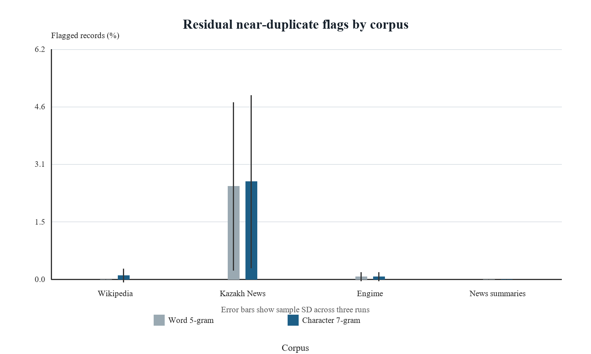
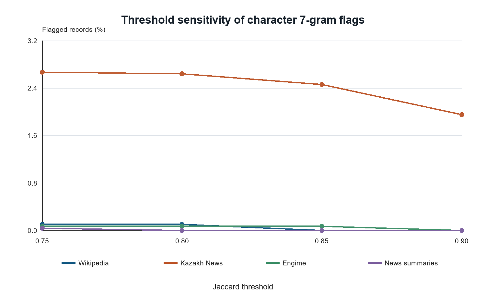

# Residual Lexical Near-Duplicates after Exact Deduplication in Four Kazakh Text Collections

Gapar Galym; Bekzat Rashiduly; Nuradilet Mustafa

Astana IT University, Astana, Kazakhstan

Correspondence: Gapar Galym (gapargalym@mail.ru)

## Abstract

Exact deduplication may leave revised or partly repeated documents in public text collections. We asked how many records with high lexical overlap remained in prespecified samples of four public Kazakh text collections. Three disjoint block samples per source comprised 12 runs and 25,500 raw rows. After eligibility screening and within-run MD5 deduplication of normalised text, 9,660 records remained; 1,309 exact repeats were removed. We compared character 7-gram and word 5-gram set Jaccard similarity at a fixed threshold of 0.80, then grouped matched pairs into connected components and retained one representative per component. The character rule marked 106 redundant records, compared with 99 for word shingles. Kazakh News contributed 103 character flags, varying from 41 to 1 to 61 across its three runs. The between-run variation in news also cautions against treating one block sample as a stable estimate. In a targeted manual review of 73 pairs, substantive repetition appeared among flagged cases, but shared templates and partial overlaps also produced false alarms; changed versions appeared below the threshold. Thus, exact removal did not eliminate substantive repetition from the sampled records. The counts are operational lexical flags within selected runs, not full-dataset prevalence estimates or a measure of semantic paraphrase detection.

**Keywords:** corpus curation; Jaccard similarity; character shingles; manual audit; dataset provenance

## 1. Introduction

Public text collections support a growing range of natural language processing applications, including the development of language models. Their reported document counts, however, need not equal the number of distinct pieces of content. Pages can be republished, articles can receive minor revisions, and collections assembled from several sources can contain repeated passages. Tumre et al. examined near-duplicate news snippets when full articles were unavailable [1]. Duplication therefore matters both for the efficient use of data and for the interpretation of experiments built on those data. Lee et al. demonstrated that repeated training material can affect model memorisation and evaluation [2]. DataComp-LM provides a controlled testbed for comparing curation choices, including deduplication, in language-model training [3]. Large corpus pipelines such as CCNet, CulturaX, and FineWeb consequently include deduplication among their cleaning steps [4–6]. These studies establish the importance of the problem, while also showing that the precise outcome depends on the documents and the cleaning procedure. Van Noord et al. found that human ratings of web-corpus quality did not directly predict downstream model rankings in their evaluation [7].

An exact-duplicate test answers a narrow question: whether two documents become identical after a specified normalisation. Hashing is an efficient way to implement that test. If a word is changed, a sentence is added, or only part of an article is reused, the texts may no longer have the same hash even though readers would recognise substantial repetition. Near-duplicate detection addresses this remaining possibility by comparing features shared by two documents rather than requiring complete identity. Broder's shingling framework represents text through overlapping token sequences and measures document resemblance through the intersection and union of the resulting sets [8]. The size of a shingle and the similarity threshold determine which kinds of changes the method can tolerate. A shingle-based score is a measure of surface-form overlap; it is not a direct judgment that two documents convey identical meaning.

Kazakh provides a useful setting for examining these distinctions. Its productive suffixation can change word forms while leaving much of a sentence's content intact. Work by Biloshchytska et al. compared lexical, hybrid, and semantic approaches to finding near-duplicate Kazakh texts [9]. Tleubayeva et al. subsequently introduced KazakhTextDuplicates, a benchmark designed to test several kinds of semantic and surface-form variation [10]. These papers supply important methods and evaluation resources. Their reported model scores, however, answer different questions from an audit of what remains inside particular public collections after an exact-removal step. We therefore report residual similarity in our specified samples without treating benchmark accuracy as an estimate of duplication in those collections.

Our study examines four sources relevant to Kazakh text curation: Kazakh Wikipedia, the Kazakh News Corpus, educational pages distributed as Engime, and the document field of a Kazakh news summarisation collection. We use the versions and row offsets recorded in the experiment manifest. For each source, three non-overlapping selections of adjacent-row blocks were processed independently. The sampling unit and the comparison boundary matter: two related records placed in different runs cannot become a detected pair in this design. The results therefore describe the selected, eligible records compared within each source and run. They should not be interpreted as rates for all rows of the underlying collections. Recent work on residual duplication in FineWeb also illustrates why extrapolating from a sampled probe to a complete corpus requires additional assumptions [11].

We first apply the prespecified eligibility rules, including the additional Kazakh-letter screen for Engime, and the same exact-removal procedure to each sample. Exact matches are identified from MD5 hashes after Unicode NFC normalisation and whitespace collapse. The remaining records form the common input to two lexical near-duplicate conditions. The primary condition uses character seven-gram sets; the comparison condition uses word five-gram sets. For each condition, pairs meeting Jaccard similarity of at least 0.80 are linked into connected components, and one representative is retained per component. The primary outcome is the number and share of records marked redundant by the character method after exact removal. We keep this record count separate from the number of similar *pairs*. A targeted manual review of 73 selected pairs helps identify substantive repetition, shared templates, and cases that the fixed threshold misses.

The research question is: **How many records with high lexical overlap remain in prespecified samples of four public Kazakh text collections after within-run exact deduplication?** The working null hypothesis states that no substantive repeated text remains in the analysed samples after exact removal; the alternative states that at least one substantive repeated pair remains. The hypotheses concern these samples, not the complete source collections. We do not test language-model performance, train a duplicate classifier, or assume that lexical overlap identifies all semantic paraphrases.

This paper makes three contributions. First, it provides a traceable audit of residual lexical redundancy after a common exact-removal step in four types of Kazakh text collection. Second, it compares character and word shingling on the same eligible records and reports variation across three disjoint runs per source rather than hiding that variation in a single aggregate. Third, it uses a manual case review to distinguish algorithmic flags from substantive repetition and to expose both false alarms and missed cases. Together, these contributions answer a practical corpus-curation question while preserving the boundaries imposed by the sampling design and the chosen similarity measure. Section 2 reviews prior work, Section 3 describes the experiment, Sections 4 and 5 present and interpret the results, and Section 6 concludes.

## 2. Related Work

### 2.1. From exact matches to lexical and semantic similarity

Exact deduplication identifies records that become identical under a specified normalisation. It is a useful first stage because its decision rule is simple and reproducible, but it cannot identify a changed headline, an appended paragraph, or a lightly revised article. Near-duplicate methods replace the all-or-nothing comparison with a similarity measure. Broder's document-resemblance formulation converts each document into a set of overlapping shingles and measures the shared fraction of the two sets [8]. It also distinguishes *resemblance*, which compares documents as wholes, from *containment*, which asks whether much of one document occurs within another. This distinction matters when a short source is embedded in a longer page: whole-document Jaccard similarity can be modest even when containment is high.

Direct comparison of all shingle sets is feasible for modest samples but becomes costly at web scale. Broder proposed compact sketches to estimate resemblance [8], while Manku et al. studied scalable detection of near-duplicate pages for a large web repository using SimHash-based fingerprints [12]. These are ways to reduce computation or find likely candidates; they do not make the definition of a duplicate independent of normalisation, document length, or threshold. Our experiment computes Jaccard scores from the sets of selected document pairs and does not implement MinHash, SimHash, or a learned candidate retriever. Its purpose is an interpretable audit of bounded samples rather than a scalable service for complete web collections.

Surface overlap also has a predictable blind spot: a paraphrase may express the same proposition with few shared shingles. Sentence-BERT introduced sentence embeddings designed for efficient semantic comparison [13]. LaBSE learns multilingual sentence representations for retrieval [14], while SemDeDup uses pretrained embeddings to identify semantically similar training instances [15]. In a study of noisy news-like duplication, Silcock et al. compared hashing and n-gram overlap with neural encoders and reported advantages for the neural approaches under the noise conditions they evaluated [16]. Li and Li proposed a generative semantic selection method for noisy social-media data [17]. These findings motivate semantic methods as a complement to lexical screening. They do not imply that an embedding score automatically proves content equivalence, or that performance on another language and corpus transfers unchanged to Kazakh. In the present study, the character and word shingle conditions are both lexical; any semantic interpretation depends on the separate manual review.

### 2.2. Deduplication as corpus curation

Large corpus projects make the cleaning pipeline part of the research result. CCNet documents web-crawl extraction and filtering for monolingual text [4]. CulturaX combines language identification, document refinement, and deduplication across many languages [5]. FineWeb investigates how filtering and deduplication choices change a large English web corpus [6], while Dolma publishes both a mixed-source corpus and extensive construction details that support reproduction [18]. HPLT v2 extends this emphasis to many languages and releases its pipeline and code [19]. The first HPLT release documented document-level deduplication in a multilingual corpus [20]. The common lesson for our study is methodological: one must state the source version, the selection boundary, the cleaning order, and the unit being counted before comparing outcomes.

Removing every similar record is not always the only sensible response to redundancy. SoftDedup reduces the training weight of common data rather than deleting all such items [21]. Our study does not evaluate language-model training or propose an optimal removal policy. Its representative-per-cluster count is an operational measure of redundancy under a fixed rule. A record marked redundant may contain a useful revision or additional information, which is one reason to examine examples rather than equate every flag with worthless data.

Reporting how many documents a pipeline removed also leaves a different question: what similar content remains after that pipeline? Zhang addresses residual duplication in FineWeb and explicitly models the difficulty of inferring corpus-level residue from a limited sample [11]. This is closest to our *question* but not to our sampling design or language. We compare only records co-located in prespecified runs. We therefore describe observed residual flags in those runs and do not extrapolate them to a full-source prevalence estimate.

### 2.3. Evidence specific to Kazakh and data quality

Kazakh's rich morphology makes the relationship between surface overlap and meaning especially important to inspect. Biloshchytska et al. evaluated a hybrid combination of lexical and semantic techniques against alternative methods on modified Kazakh text fragments [9]. Tleubayeva et al. introduced KazakhTextDuplicates, with a diagnostic version derived from naturally occurring pairs and a controlled version covering several transformation regimes [10]. Their benchmark separates the testing of semantic similarity and retrieval models from the description of naturally occurring overlap. These studies are the closest language-specific work, but their model scores are not estimates of how many revised or repeated records survive an exact-hash step in our four sampled collections.

Two further studies are useful for the practical framing of the article. KazakhLawCorpus shows how a Kazakh-language collection can preserve source values and release diagnostic quality flags rather than remove all unusual or repeated-looking records [22]. Its units are legislative metadata records, so its duplicate-group counts cannot be compared with our text-level flags. Martins et al. benchmark data-cleaning tools across structured datasets and report how tool and workflow choices affect cleaning outcomes [23]. Their domain differs from ours, but the paper demonstrates that a transparent comparative data-cleaning study fits the scope of the proposed target journal, *Data*.

### 2.4. What the closest studies leave for this paper

**Table 1. Closest studies, their contributions to this design, and the boundaries of comparison.**

| Study | Main object of study | What it contributes to our design | Boundary relative to our question |
| --- | --- | --- | --- |
| Broder [8] | Document resemblance and containment | Shingles and set-based similarity | Defines measures; does not audit Kazakh corpora |
| Biloshchytska et al. [9] | Detection methods on modified Kazakh fragments | Lexical versus hybrid/semantic comparison | Measures detector performance, not post-exact residue in our collections |
| Tleubayeva et al. [10] | Kazakh duplicate benchmark | Categories of surface and semantic variation | Benchmark pairs do not estimate residue in four public source samples |
| Zhang [11] | Residual duplication in FineWeb | Sampling caution and a direct residual-duplication question | Different corpus, scale, language, and estimation design |
| This study | Selected blocks from four Kazakh collections | Traceable post-exact lexical audit with two shingle types and manual cases | Estimates only within-run sample flags, not whole-corpus prevalence |

Table 1 compares the closest studies with our question and design. The gap is therefore specific rather than a claim that Kazakh near-duplicate detection has not been studied. We ask what an exact-removal step leaves behind in selected public Kazakh text collections under an explicitly stated lexical rule. The comparison of character and word shingles shows how the operational answer changes with representation, and the case review shows why the resulting record counts must be interpreted with care. Klie et al. document common weaknesses in the quality management of NLP dataset annotation [24]. Their analysis reinforces the need to describe our manual selection and labels precisely: the 73 reviewed pairs illuminate error types, but a targeted sample of difficult cases cannot support a corpus-wide precision or recall estimate.

## 3. Materials and Methods

### 3.1. Study design and units of analysis

We audited residual lexical near-duplicates after exact deduplication in four public Kazakh text collections. The research question concerned sampled records, not complete-dataset prevalence. Three disjoint samples per collection underwent the same processing, giving 12 corpus-by-sample runs. A *record* is a dataset row; a *pair* is two records compared for similarity; and a *redundant record* is a non-representative member of a similarity cluster. We compared records only within the same collection and run.

The four train splits were the Kazakh Wikipedia snapshot (`wikimedia/wikipedia`, configuration `20231101.kk`, field `text`), Kazakh News Corpus (`kurumikz/kaz-news-corpus`, `content`), Engime educational pages (`nyuuzyou/engime`, `text`), and Kazakh news summarization documents (`shayekh/kazakh-news-summarization-20k-adapted`, `document`). Their recorded train-split sizes at protocol freeze were 238,615, 23,638, 2,677,221, and 32,599 rows, respectively. The protocol retains repository revisions, fields, block offsets, and a selection SHA-256. The script checked source revisions before and after retrieval.

### 3.2. Sampling and eligibility

We divided each train split into complete blocks of 100 consecutive rows and excluded Assignment 3 pilot blocks. For each collection and seed, a Python pseudorandom generator selected blocks without replacement; offsets were recorded before similarity results were inspected. The seeds, 20261105, 20261106, and 20261107, reproduce the row selection. Each run used 30 Wikipedia, 20 Kazakh News, 15 Engime, and 20 News Summary blocks: 8,500 raw rows per round and 25,500 in total. Retrieved row indices were checked against the manifest. Because rows within blocks are adjacent, this is not a simple random sample of individual records.

We excluded a row if its required text field was missing or empty. The remaining text was normalised to Unicode NFC; runs of whitespace were replaced with a single space and outer whitespace removed. Word count was then computed by whitespace splitting. Records with fewer than 150 or more than 5,000 words were excluded. Because Engime contains mixed-language material, its rows also had to contain at least three Kazakh-specific letters from `әғқңөұүһі`, and those letters had to constitute at least 1% of alphabetic characters. This is a transparent heuristic language screen, not a validated language classifier. All filters were applied before deduplication, and the exclusions were counted for each run.

### 3.3. Exact deduplication

For each eligible record, we computed the MD5 digest of its NFC- and whitespace-normalised UTF-8 text. Within each collection and run, the first occurrence of each digest was retained and later occurrences removed. Spacing and Unicode composition differences are treated as exact after normalisation, while changes in case, punctuation, wording, or word order generally produce a different digest. MD5 was an equality key, not a similarity score. The code does not verify byte equality after a digest match, so hash collision is a theoretical limitation. This step supplies the common input for both lexical methods. Its near-duplicate flag count is zero by design, not evidence of an absence of near-duplicates.

### 3.4. Lexical similarity and candidate comparisons

For similarity scoring, each retained text underwent a second normalisation: case folding, replacement of each non-alphanumeric character with a space, and another whitespace collapse. We then built two alternative sets of overlapping shingles. The word baseline uses every contiguous sequence of five words, joined by spaces. The character condition uses every contiguous sequence of seven characters in the normalised string, including spaces. Repeated occurrences of the same shingle contribute once because the representation is a set. The two conditions therefore use the same records and decision threshold but different units of overlap.

For two shingle sets, \(A\) and \(B\), the Jaccard score is \(J(A,B)=|A\cap B|/|A\cup B|\). Scores range from zero for disjoint sets to one for identical sets. The primary threshold was 0.80 for both methods. We also retained pairs scoring at least 0.75 and recomputed cluster counts at 0.75, 0.85, and 0.90 as the prespecified threshold-sensitivity analysis. We calculated exact set intersections for the pairs considered; the implementation did not use TF-IDF, BERT, embeddings, MinHash, or SimHash. It therefore measures lexical overlap and cannot, by itself, identify a paraphrase that shares few surface shingles.

To avoid comparisons that could not meet any studied threshold, records were ordered by shingle-set size. For a smaller set \(A\) and a larger set \(B\), the maximum possible Jaccard score is \(|A|/|B|\). A pair was skipped if that ratio was below 0.75. This bound cannot discard a pair that would score at least 0.80. All remaining pairs were scored directly; the number scored and the number skipped were saved for each method and run. The comparison is quadratic in the number of eligible records in the worst case, which is why the present study is a bounded audit rather than a full-corpus indexing system.

### 3.5. Clusters and outcome measures

At each threshold, we connected records whose pair score met or exceeded that threshold and formed connected components with a union-find procedure. A component may contain records linked through an intermediate record even when its end records do not directly reach the threshold. We selected one representative per component: the longest retained text, with the earlier source-row index breaking a length tie. Every other member was counted as a redundant record under that method and threshold. This is an operational deletion count; the experiment saved the full results and row indices rather than rewriting the source datasets. The primary outcome was the number of redundant post-exact records divided by the post-exact record count, calculated separately for each corpus and run under character 7-gram Jaccard at 0.80. Secondary outcomes included the corresponding word 5-gram rate, matched-pair count, retained-record count, exact removals, and runtime. Pair counts must not be substituted for redundant-record counts: several matching pairs can belong to one cluster.

### 3.6. Manual examination of candidate pairs

To assess what the lexical flags meant, a team member examined 73 selected pairs using side-by-side source texts and a written coding guide. The review comprised 33 pairs flagged at 0.80 by at least one method and 40 high-scoring pairs below both methods' threshold. Flagged pairs were sampled with a fixed pseudorandom seed, balanced across the three runs where possible, with a cap of 30 per collection; below-threshold pairs were taken from the nearest available candidates, ten per collection. The review contains two flagged Wikipedia pairs, 30 Kazakh News pairs, one Engime pair, and none from News Summary, plus ten below-threshold pairs per source. The protocol allowed up to 30 below-threshold pairs per collection; the implemented ten remained within that cap.

The guide distinguished `repeated_body` (substantially the same article or lesson), `changed_version` (a substantial revised or shortened version), `partial_overlap` (shared passages but materially different whole records), `shared_template_only` (matching boilerplate rather than main content), `unrelated`, and `uncertain`. We treated the first two labels as confirmed substantive repetition for the study's descriptive hypothesis. The other labels do not establish whole-record duplication. This targeted review supports error analysis and examples; it cannot estimate full-corpus precision or recall. In particular, the below-threshold candidates were chosen for high similarity, so their confirmed repeated cases cannot be converted into a general false-negative rate. One recorded reviewer made the labels, and no inter-annotator agreement statistic is available.

### 3.7. Summaries, inference, and reproducibility

For each collection, we reported three run-level rates and their arithmetic mean and sample standard deviation. We compared character and word methods as paired conditions on the same run-level input, expressing the mean difference in percentage points. An exact two-sided sign-flip test enumerated all eight sign assignments for the three paired differences; Holm adjustment was applied across four collection-level comparisons. With only three runs, the smallest non-zero two-sided p-value is 0.25, and disjoint blocks from the same collection are not fully independent. We consequently interpret this analysis as exploratory and do not use it to claim that one method is statistically superior or that the sample rate estimates full-corpus prevalence.

The main experiment uses Python 3.12 standard-library code; a separate summarisation script uses Pillow to produce figures. The saved protocol and results contain revisions, offsets, seeds, exclusions, method parameters, and audit identifiers. The protocol and Appendix A were frozen locally before the final runs, but Appendix A was uploaded to Moodle with the completed work rather than before execution; this deviation is disclosed. Retrieval retries and cached checkpoints addressed rate limiting without changing the sample or parameters. Raw third-party review texts remain local; the shareable audit table contains identifiers, scores, and decisions.

## 4. Results

### 4.1. Record flow through the pipeline

Across the four collections and three disjoint runs per collection, the fixed manifest retrieved 25,500 raw rows. Eligibility screening excluded 14,531 rows: 1,400 with a missing or empty selected text field, 12,355 with fewer than 150 words, 64 with more than 5,000 words, and 712 Engime rows that did not pass the Kazakh-letter screen. Thus, 10,969 records entered within-run MD5 deduplication. It removed 1,309 exact matches after NFC and whitespace normalisation, leaving 9,660 post-exact records for both lexical methods. Of these MD5 removals, 1,201 came from Engime and 108 from News Summary; none occurred in the selected Wikipedia or Kazakh News runs. These counts describe the sampled rows and the specified text fields, not the complete source collections.

**Table 2. Record flow and method flags at Jaccard ≥ 0.80, summed across three runs per collection.** The last two columns count redundant *records* after connected-component clustering, rather than matched pairs.

| Collection | Raw rows | Post-exact records | MD5 removals | Character 7-gram flags | Word 5-gram flags |
| --- | ---: | ---: | ---: | ---: | ---: |
| Kazakh Wikipedia | 9,000 | 1,575 | 0 | 2 | 0 |
| Kazakh News Corpus | 6,000 | 3,834 | 0 | 103 | 98 |
| Engime educational pages | 4,500 | 1,323 | 1,201 | 1 | 1 |
| News Summary documents | 6,000 | 2,928 | 108 | 0 | 0 |
| **Total** | **25,500** | **9,660** | **1,309** | **106** | **99** |

### 4.2. Residual lexical flags across runs

The character method flagged 106 redundant records at the primary 0.80 threshold; the word baseline flagged 99 on the same post-exact inputs (Table 2). Every word-flagged record was also character-flagged in these runs. Seven records were flagged only by the character condition: two in Wikipedia and five in Kazakh News. This is a difference in operational flags, not a count of seven additional confirmed substantive duplicates. The between-run variation was substantial, especially in Kazakh News. Its character flags were 41, 1, and 61 across the three seeds, despite comparable post-exact sample sizes (1,292, 1,226, and 1,316). Consequently, a single run would have given a misleadingly stable impression of this collection.

**Table 3. Run-level post-exact records and redundant-record flags at 0.80.** Seeds identify prespecified, non-overlapping block samples.

| Collection | Seed | Post-exact | Character flags | Word flags |
| --- | ---: | ---: | ---: | ---: |
| Wikipedia | 20261105 | 537 | 0 | 0 |
| Wikipedia | 20261106 | 645 | 2 | 0 |
| Wikipedia | 20261107 | 393 | 0 | 0 |
| Kazakh News | 20261105 | 1,292 | 41 | 37 |
| Kazakh News | 20261106 | 1,226 | 1 | 1 |
| Kazakh News | 20261107 | 1,316 | 61 | 60 |
| Engime | 20261105 | 500 | 0 | 0 |
| Engime | 20261106 | 334 | 0 | 0 |
| Engime | 20261107 | 489 | 1 | 1 |
| News Summary | 20261105 | 890 | 0 | 0 |
| News Summary | 20261106 | 945 | 0 | 0 |
| News Summary | 20261107 | 1,093 | 0 | 0 |

The mean character-flag rate across the three Kazakh News runs was 2.630% (sample SD 2.325%), versus 2.502% (SD 2.261%) for word shingles, a mean paired difference of 0.129 percentage points. Wikipedia's mean character rate was 0.103% (SD 0.179%), compared with zero for word shingles. Engime's two methods each had a mean of 0.068% (SD 0.118%), and both methods produced zero flags in News Summary at 0.80. These are arithmetic means of run-level rates; dividing the aggregate flags in Table 2 by aggregate post-exact records produces slightly different, size-weighted values. Figure 1 visualises the run means and sample standard deviations.

**Figure 1.** Mean percentage of post-exact records flagged under each lexical method. Error bars show sample standard deviation across three runs.

### 4.3. Sensitivity to the similarity threshold

The prespecified character-shingle thresholds produced the expected non-increasing flag counts as the requirement for overlap increased. In Kazakh News, the run-summed counts were 104 at 0.75, 103 at 0.80, 96 at 0.85, and 76 at 0.90. The corresponding *mean run-level rates* were 2.657%, 2.630%, 2.450%, and 1.942% (Figure 2). Wikipedia had two flags at both 0.75 and 0.80, then none at 0.85 or 0.90. Engime had one flag through 0.85 and none at 0.90. News Summary had one flag only at 0.75, so its zero at the primary threshold should not be read as the absence of every lexically similar pair. Changing the threshold changes the operational answer; the audit below addresses whether the pairs reflect substantive repetition.

**Figure 2.** Mean percentage of post-exact records flagged by character 7-grams at four prespecified Jaccard thresholds, by collection.

### 4.4. What the 73 reviewed pairs showed

The targeted review comprised 33 pairs flagged by at least one method at 0.80 and 40 nearest available pairs below both methods' threshold. Among the 33 flagged pairs, the reviewer labelled 27 `repeated_body` and three `changed_version`, giving 30 confirmed substantive repeated pairs *within the reviewed set*. Two flagged Wikipedia pairs were `partial_overlap`: biographies of different singers shared a long group-background section rather than the same whole article. One Kazakh News pair, despite character and word scores above 0.98, was `shared_template_only`: two navigation pages repeated links without a substantive article body. Thus, a high lexical score was not sufficient on its own to establish a whole-record duplicate.

Of the 40 selected below-threshold pairs, seven were labelled `changed_version`, 13 `partial_overlap`, 19 `shared_template_only`, and one `unrelated`. One Kazakh News example, rows 2919 and 12596 in seed 20261106, was judged a revised version although its character score was 0.758 and word score 0.529. These seven reviewed cases illustrate threshold misses; they do not estimate recall, because the below-threshold subset was deliberately selected for high similarity. Likewise, 30 of 33 substantive flagged pairs is not a precision estimate for every flagged pair or every source. The review used one recorded annotator and has no inter-annotator agreement measure.

### 4.5. Exploratory paired comparison

The exact sign-flip test on three paired run-level rate differences yielded an unadjusted two-sided p-value of 0.50 for Kazakh News and 1.00 for each other collection. Holm-adjusted p-values were 1.00 for all four comparisons. With three runs and a minimum non-zero two-sided p-value of 0.25, the tests provide no evidence that one shingle method is superior. The descriptive finding is narrower and stronger: after MD5 exact removal, the sampled records still contained lexical near-duplicate candidates, and the targeted manual review confirmed substantive repeated text among them.

## 5. Discussion

### 5.1. What remains after exact removal

The descriptive hypothesis was supported in the sampled records: after MD5 removal, the character-shingle method produced candidate pairs, and manual examination confirmed substantive repeated content in some of them. Reviewed Kazakh News pairs included repeated articles and changed versions, as did one Engime lesson-plan pair. The number 106 counts records marked redundant by a lexical clustering rule, whereas the 30 confirmed substantive cases are *pairs within a selected manual-review set*. The two measures cannot be exchanged or added. The zero automatic flags in News Summary apply only to its eligible sampled rows.

Engime contributed 1,201 of the 1,309 MD5 removals, while the selected Kazakh News runs contributed none. Yet Kazakh News accounted for 103 of the 106 character flags *after* exact removal. A single exact-hash count therefore does not describe remaining overlap under a near-duplicate rule. The collections also differ in document types, missing fields, length distributions, and sampled blocks. Kazakh News character counts of 41, 1, and 61 across runs show sensitivity to block selection. Of 30 reviewed flagged news pairs, 27 had the same non-empty source URL, consistent with repeated or revised source pages.

### 5.2. What the two shingle methods measure

In these samples, every word-flagged record was also character-flagged, and the character rule marked seven additional records. This small descriptive difference should not be presented as superior detection. Two additional Wikipedia flags came from a three-record cluster of distinct biographies sharing a long background passage. The manual reviewer judged the two selected matching pairs to be partial overlap rather than repeated whole articles. Conversely, two of the reviewed character-only Kazakh News pairs were labelled substantive repetition. Character shingles may retain overlap across small spelling or word-form changes, but our experiment did not isolate Kazakh morphology as a causal factor. The adjusted paired tests were uninformative with three runs, so the evidence supports neither statistical superiority nor practical interchangeability of the two rules.

The 0.80 threshold is a decision rule, not a natural boundary between duplicates and non-duplicates. The reviewed high-scoring news navigation pair repeated a template without a substantive article body, while seven deliberately selected pairs below 0.80 were judged changed versions. Increasing the character threshold from 0.80 to 0.90 reduced Kazakh News flags from 103 to 76 across the three runs, but a lower count cannot be interpreted as higher quality without reviewing the cases lost. A whole-document Jaccard score also penalises a shorter article embedded in a much longer version; Broder's distinction between resemblance and containment is relevant to that case [8]. Connected-component clustering adds another interpretive step: records A and C can share a cluster through B even if their own pair score is below the threshold. Thus, the retained-record counts are properties of the entire fixed pipeline, including normalisation, shingle size, threshold, and representative selection.

### 5.3. Relation to previous work

The Kazakh-specific studies by Biloshchytska et al. [9] and Tleubayeva et al. [10] motivate attention to morphological variation, paraphrases, and partial semantic overlap. Their evaluations ask how detectors perform on benchmark pairs, including controlled transformations; ours asks what lexical overlap remains among selected source records after exact removal. Their reported model scores therefore cannot be ranked against our flag percentages. The seven reviewed changed versions below our threshold show why benchmark regimes involving paraphrase or reformulation are relevant to a follow-up, while also reminding us that manual labels are needed to determine whether a flagged pair repeats the substantive body. Our results neither evaluate BERT nor show that a semantic method would improve this corpus audit.

Zhang's residual-duplication study [11] makes the sampling problem explicit: a duplicate can be missed because its partner lies outside the observed subset, even when the detector would recognise the pair. Our design has that limitation, since comparisons never cross sampled blocks assigned to different runs or source collections. Unlike Zhang's sampling-inversion design, ours has no basis for estimating duplication prevalence in the full datasets. The observed rates are conditional on our source versions, eligibility filters, and fixed within-run samples. They can be compared within this pipeline, but not directly with residual rates from a different corpus or threshold.

### 5.4. Implications and limitations

For corpus curation, the practical contribution is a checkable sequence: record the source version and sample, remove exact matches, screen the remaining texts with a stated lexical rule, and inspect candidate pairs before deciding what to retain. The longest-record representative rule makes the count reproducible; it is not a recommendation to discard every shorter revision. A revised page can contain distinct material, and a shared template can make unrelated records look similar. A curator could preserve cluster membership and provenance, then make a content decision after review. Niemi et al. combined fingerprints and text alignment in another domain and validated the results against manually reviewed medical-document pairs [25].

Several constraints limit inference. Adjacent 100-row blocks are not independent document draws, and the 150–5,000-word filter excludes many source rows. Engime's Kazakh-letter rule is only a heuristic. We compared records within each source and run, leaving cross-run, cross-source, and out-of-sample partners unexamined. The 73-pair audit intentionally favoured flagged and near-threshold cases; it has one recorded reviewer and no agreement estimate, so it cannot supply unbiased precision, recall, or a corpus-wide duplicate rate. The locally frozen protocol supports checking that the chosen offsets and parameters preceded the runs, but the required Moodle upload happened only with the completed submission. This procedural deviation should remain disclosed rather than described as preregistration on Moodle.

A stronger follow-up would sample more widely, search for partners across source and run boundaries, and review a probability sample of pairs with two bilingual annotators. A morphology-aware or semantic condition could then be compared with the present lexical rules on the *same* labelled records. Only a separate language-model training experiment could test whether a particular removal policy improves downstream performance; that outcome was outside this study.

## 6. Conclusion

Exact deduplication did not remove all substantive repetition from the selected Kazakh text records. Across four public collections, three disjoint block samples per collection yielded 25,500 raw rows and 9,660 eligible records after screening and within-run MD5 removal. At the prespecified Jaccard threshold of 0.80, character 7-gram clustering marked 106 post-exact records as redundant, compared with 99 under word 5-grams. The targeted review of 73 pairs confirmed repeated article or lesson content among the automatic candidates, supporting the study's alternative hypothesis for the analysed samples. It also identified partial overlaps and shared templates among flags, as well as changed versions below the threshold. Automatic flag totals therefore describe the chosen lexical rule, not a verified count of all substantive duplicates.

The results were concentrated in Kazakh News and varied markedly across its three runs. The small difference between character and word flag counts did not establish that one method is superior: the paired tests were coarse with only three runs, and some character-only flags were not whole-record repeats. Our estimates apply to eligible records compared within the same source and run. They do not measure duplication across full datasets, detect every semantic paraphrase, or show effects on language-model training.

For a stronger estimate, future work should expand the sampling frame and search for partners across run and source boundaries, then assess a probability sample of pairs with two independent bilingual reviewers. A semantic or morphology-aware method could be evaluated on those same labelled pairs. Until such evidence is available, the present pipeline is best used as a reproducible audit that directs human attention to potentially repeated content after exact cleaning.

## Author Contributions

Methodology, Bekzat Rashiduly; software and formal analysis, Gapar Galym; investigation (manual review of 73 pairs), Bekzat Rashiduly; investigation (literature review), Nuradilet Mustafa; writing—original draft, Gapar Galym, Bekzat Rashiduly and Nuradilet Mustafa; writing—review and editing, all three authors. All authors have read and approved the manuscript.

## Funding

This research received no external funding. The authors used their own resources.

## Data and Code Availability

The four source datasets are publicly hosted on Hugging Face; their repository revisions, text fields, and selected row offsets are recorded in the frozen protocol. The analysis code, per-run JSON results, summary table, figures, metadata-only audit cases, and a paper-specific reproduction guide are available in the [project repository](https://github.com/Gapo-7/kazakh-near-duplicate-audit-assignment4). The code is released under the MIT License. The source dataset cards and public repository contents were reviewed on 17 November 2026. Cached raw source texts and the local side-by-side review sheet are not redistributed; their upstream licences are separate from the code licence. The [final tagged release](https://github.com/Gapo-7/kazakh-near-duplicate-audit-assignment4/releases/tag/final) contains the manuscript, code, result logs and paper-specific reproduction guide.

## Acknowledgments and AI Use

OpenAI ChatGPT/Codex was used to help plan the study, prepare and inspect analysis code, check numerical consistency, and draft and edit manuscript text. The authors reviewed and edited the output and take responsibility for the final manuscript. The exact tool version and prompt record should be added before an actual submission to *Data*.

## Conflicts of Interest

The authors declare no conflict of interest.

## Ethics Statement

The study analysed publicly available text collections and did not recruit human participants. Human-participant ethics approval and informed consent were not applicable. Downloaded source texts and the local side-by-side review file are not redistributed.

## References

1. Tumre, S.; Patil, S.; Kumar, A. Improved Near-Duplicate Detection for Aggregated and Paywalled News-Feeds. In Proceedings of the 2025 Conference of the Nations of the Americas Chapter of the Association for Computational Linguistics: Human Language Technologies (Volume 3: Industry Track), 2025; pp. 979–987. https://doi.org/10.18653/v1/2025.naacl-industry.73
2. Lee, K.; Ippolito, D.; Nystrom, A.; Zhang, C.; Eck, D.; Callison-Burch, C.; Carlini, N. Deduplicating Training Data Makes Language Models Better. In Proceedings of the 60th Annual Meeting of the Association for Computational Linguistics (Volume 1: Long Papers), 2022; pp. 8424–8445. https://doi.org/10.18653/v1/2022.acl-long.577
3. Li, J.; Fang, A.; Smyrnis, G.; Ivgi, M.; Jordan, M.; Gadre, S.; Bansal, H.; Guha, E.; Keh, S.; Arora, K.; et al. DataComp-LM: In search of the next generation of training sets for language models. In Advances in Neural Information Processing Systems 37, 2024; pp. 14200–14282. https://doi.org/10.52202/079017-0455
4. Wenzek, G.; Lachaux, M.A.; Conneau, A.; Chaudhary, V.; Guzmán, F.; Joulin, A.; Grave, E. CCNet: Extracting High Quality Monolingual Datasets from Web Crawl Data. In Proceedings of the Twelfth Language Resources and Evaluation Conference, Marseille, France, May 2020; pp. 4003–4012. https://aclanthology.org/2020.lrec-1.494/
5. Nguyen, T.; Nguyen, C.V.; Lai, V.D.; Man, H.; Ngo, N.T.; Dernoncourt, F.; Rossi, R.A.; Nguyen, T.H. CulturaX: A Cleaned, Enormous, and Multilingual Dataset for Large Language Models in 167 Languages. In Proceedings of LREC-COLING 2024, Torino, Italy, May 2024; pp. 4226–4237. https://aclanthology.org/2024.lrec-main.377/
6. Penedo, G.; Kydlícek, H.; Allal, L.; Lozhkov, A.; Mitchell, M.; Raffel, C.; Werra, L.V.; Wolf, T. The FineWeb Datasets: Decanting the Web for the Finest Text Data at Scale. In Advances in Neural Information Processing Systems 37, 2024; pp. 30811–30849. https://doi.org/10.52202/079017-0970
7. van Noord, R.; Kuzman, T.; Rupnik, P.; Ljubešić, N.; Esplà-Gomis, M.; Ramírez-Sánchez, G.; Toral, A. Do Language Models Care about Text Quality? Evaluating Web-Crawled Corpora across 11 Languages. In Proceedings of LREC-COLING 2024, Torino, Italy, May 2024; pp. 5221–5234. https://aclanthology.org/2024.lrec-main.465/
8. Broder, A. On the resemblance and containment of documents. In Proceedings. Compression and Complexity of SEQUENCES 1997 (Cat. No.97TB100171), 1997; pp. 21–29. https://doi.org/10.1109/SEQUEN.1997.666900
9. Biloshchytska, S.; Tleubayeva, A.; Kuchanskyi, O.; Biloshchytskyi, A.; Andrashko, Y.; Toxanov, S.; Mukhatayev, A.; Sharipova, S. Text Similarity Detection in Agglutinative Languages: A Case Study of Kazakh Using Hybrid N-Gram and Semantic Models. Applied Sciences 2025, 15, 6707. https://doi.org/10.3390/app15126707
10. Tleubayeva, A.; Biloshchytska, S.; Kuchanskyi, O.; Andrashko, Y.; Sarisaray Boluk, P.; Lisnevskyi, R.; Mukhatayev, A. KazakhTextDuplicates: A Controlled Multi-Regime Benchmark for Semantic Deduplication, Semantic Similarity, and Retrieval in Kazakh. Data 2026, 11, 133. https://doi.org/10.3390/data11060133
11. Zhang, G. How Many Duplicates Are Left? Capture-Recapture and Sampling Inversion for Residual Duplication in FineWeb. In Proceedings of the 13th Web-as-Corpus Workshop, Budapest, Hungary, October 2026; pp. 170–181. https://doi.org/10.18653/2026.wac-1.16
12. Manku, G.S.; Jain, A.; Das Sarma, A. Detecting near-duplicates for web crawling. In Proceedings of the 16th international conference on World Wide Web, 2007; pp. 141–150. https://doi.org/10.1145/1242572.1242592
13. Reimers, N.; Gurevych, I. Sentence-BERT: Sentence Embeddings using Siamese BERT-Networks. In Proceedings of the 2019 Conference on Empirical Methods in Natural Language Processing and the 9th International Joint Conference on Natural Language Processing (EMNLP-IJCNLP), 2019; pp. 3980–3990. https://doi.org/10.18653/v1/D19-1410
14. Feng, F.; Yang, Y.; Cer, D.; Arivazhagan, N.; Wang, W. Language-agnostic BERT Sentence Embedding. In Proceedings of the 60th Annual Meeting of the Association for Computational Linguistics (Volume 1: Long Papers), 2022; pp. 878–891. https://doi.org/10.18653/v1/2022.acl-long.62
15. Abbas, A.; Tirumala, K.; Simig, D.; Ganguli, S.; Morcos, A.S. SemDeDup: Data-Efficient Learning at Web-Scale Through Semantic Deduplication. In Proceedings of the Multimodal Representation Learning Workshop at ICLR 2023, 2023. https://arxiv.org/abs/2303.09540
16. Silcock, E.; D’Amico-Wong, L.; Yang, J.; Dell, M. Noise-Robust De-Duplication at Scale. In Proceedings of the International Conference on Learning Representations, 2023. https://arxiv.org/abs/2210.04261
17. Li, X.; Li, J. Generative Deduplication For Socia Media Data Selection. In Findings of the Association for Computational Linguistics: EMNLP 2024, 2024; pp. 5765–5776. https://doi.org/10.18653/v1/2024.findings-emnlp.330
18. Soldaini, L.; Kinney, R.; Bhagia, A.; Schwenk, D.; Atkinson, D.; Authur, R.; Bogin, B.; Chandu, K.; Dumas, J.; Elazar, Y.; et al. Dolma: an Open Corpus of Three Trillion Tokens for Language Model Pretraining Research. In Proceedings of the 62nd Annual Meeting of the Association for Computational Linguistics (Volume 1: Long Papers), 2024; pp. 15725–15788. https://doi.org/10.18653/v1/2024.acl-long.840
19. Burchell, L.; De Gibert Bonet, O.; Arefyev, N.; Aulamo, M.; Bañón, M.; Chen, P.; Fedorova, M.; Guillou, L.; Haddow, B.; Hajič, J.; et al. An Expanded Massive Multilingual Dataset for High-Performance Language Technologies (HPLT). In Proceedings of the 63rd Annual Meeting of the Association for Computational Linguistics (Volume 1: Long Papers), 2025; pp. 17452–17485. https://doi.org/10.18653/v1/2025.acl-long.854
20. de Gibert, O.; Nail, G.; Arefyev, N.; Bañón, M.; van der Linde, J.; Ji, S.; Zaragoza-Bernabeu, J.; Aulamo, M.; Ramírez-Sánchez, G.; Kutuzov, A.; et al. A New Massive Multilingual Dataset for High-Performance Language Technologies. In Proceedings of LREC-COLING 2024, Torino, Italy, May 2024; pp. 1116–1128. https://aclanthology.org/2024.lrec-main.100/
21. He, N.; Xiong, W.; Liu, H.; Liao, Y.; Ding, L.; Zhang, K.; Tang, G.; Han, X.; Wei, Y. SoftDedup: an Efficient Data Reweighting Method for Speeding Up Language Model Pre-training. In Proceedings of the 62nd Annual Meeting of the Association for Computational Linguistics (Volume 1: Long Papers), 2024; pp. 4011–4022. https://doi.org/10.18653/v1/2024.acl-long.220
22. Tleubayeva, A.; Mansurova, A.; Shomanov, A.; Makhambetova, Z.; Boluk, P.S. KazakhLawCorpus: A Large-Scale Metadata Corpus for Kazakh Legislation. Data 2026, 11, 217. https://doi.org/10.3390/data11090217
23. Martins, P.; Cardoso, F.; Váz, P.; Silva, J.; Abbasi, M. Performance and Scalability of Data Cleaning and Preprocessing Tools: A Benchmark on Large Real-World Datasets. Data 2025, 10, 68. https://doi.org/10.3390/data10050068
24. Klie, J.C.; Eckart de Castilho, R.; Gurevych, I. Analyzing Dataset Annotation Quality Management in the Wild. Computational Linguistics 2024, 50, 817–866. https://doi.org/10.1162/coli_a_00516
25. Niemi, T.; Ghobril, J.P.; Defossez, G.; Germann, S.; Martin, E.; Bulliard, J.L. Automatic (near-) duplicate content document detection in a cancer registry. International Journal of Medical Informatics 2025, 195, 105799. https://doi.org/10.1016/j.ijmedinf.2025.105799
